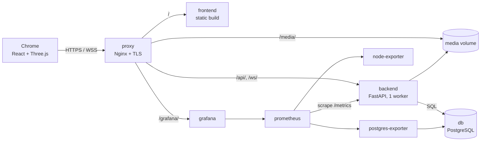
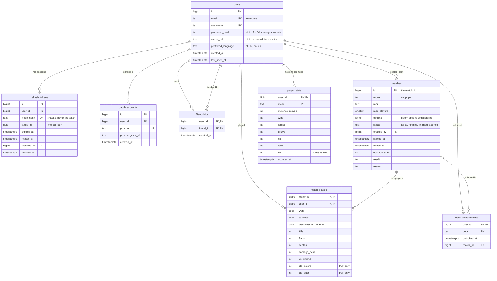

*This project has been created as part of the 42 curriculum by \<login1\>, acesar-m, \<login3\>, \<login4\>, \<login5\>.*

> **TODO F9.1 (@robertodelfranco):** replace one `<loginN>` above with your 42 intra login.
>
> **TODO F9.1 (@rflheringer):** replace one `<loginN>` above with your 42 intra login.
>
> **TODO F9.1 (@caioosantos):** replace one `<loginN>` above with your 42 intra login.
>
> **TODO F9.1 (@kanashir0):** replace one `<loginN>` above with your 42 intra login.

# Catacombs 42

A real-time 3D dungeon crawler in the browser: up to five friends fight their way to the boss together, or two players duel in a 1v1 arena, all on top of a full web platform with accounts, friends, stats and rankings.

## Table of contents

1. [Description](#description)
2. [Instructions](#instructions)
3. [How to play](#how-to-play)
4. [Team Information](#team-information)
5. [Project Management](#project-management)
6. [Technical Stack](#technical-stack)
7. [Architecture overview](#architecture-overview)
8. [Database Schema](#database-schema)
9. [Features List](#features-list)
10. [Modules](#modules)
11. [Monitoring guide](#monitoring-guide)
12. [Individual Contributions](#individual-contributions)
13. [Known limitations](#known-limitations)
14. [Resources](#resources)
15. [Credits](#credits)

## Description

**Catacombs 42** is our ft_transcendence: the bonus part of the 42 *Cub3D* project, rebuilt as a real 3D multiplayer game that runs in the browser.

The game rules and the movement math come from the original C code. Here they run on an **authoritative server**: the server decides every hit, every point of damage, every pickup and every win. The browser only draws the world and sends what the player pressed. Around the game there is a full website for signing up, finding friends, joining a match and following your progress.

**Goal:** show that a game born as a single-player raycaster in C can become a fair, real-time, multiplayer web game, with the same physics on the client and on the server, behind a production-like stack (HTTPS, a single command to start it, monitoring).

**Key features**

- **Co-op for 2 to 5 players, or Solo:** explore the dungeon, collect keys to open doors and defeat the boss together. A Solo Room is a co-op Room with a single seat, to play alone.
- **PvP 1v1:** first to the frag limit, or most frags when time runs out, wins (5 frags or 3 minutes by default).
- **Real 3D** with Three.js: two visual themes, animated sprites, lighting effects, sound and a minimap.
- **Responsive online play:** client-side prediction, server reconciliation, interpolation of other players, and reconnection within 30 seconds.
- **Customizable matches:** map, theme, starting HP, which pickups exist, PvP frag and time limits.
- **Accounts:** sign up with e-mail and password, or log in with your **42 intra** account (OAuth 2.0). Profile with avatar, friends list and online status.
- **Progression:** stats per mode, match history, XP and levels, Elo ranking in PvP, achievements and a leaderboard.
- **Three languages:** Brazilian Portuguese, English and Spanish, including legal pages and error messages.
- **Monitoring:** Prometheus metrics from the backend, host and database, Grafana dashboards and alerting rules.

## Instructions

### Prerequisites

| Tool | Version we use | Notes |
|---|---|---|
| Docker Engine | 29.x (24+ should work) | everything runs in containers; no local Python or Node needed |
| Docker Compose | v2 plugin (`docker compose`) | tested with v5.4 |
| Google Chrome | latest stable | the supported browser |
| [mkcert](https://github.com/FiloSottile/mkcert) | 1.4.x | optional, for a certificate the browser trusts |
| 42 intra API app | — | optional, only for "Log in with 42" |

### Services

Everything is started by Docker Compose on one bridge network (`transcendence`). Only `proxy` publishes ports to the host; the other services talk to each other by service name.

| Service | Image / build | Role |
|---|---|---|
| `proxy` | `./proxy` (Nginx) | TLS termination; routes `/`, `/api/`, `/ws/`, `/media/` and `/grafana/` |
| `frontend` | `./frontend` (Nginx) | serves the production build of the React app and the game |
| `backend` | `./backend` (Python 3.12) | FastAPI on port 8000: REST API, WebSockets and the game simulation |
| `db` | `postgres:16-alpine` | PostgreSQL; data in the `db_data` volume |
| `prometheus` | `prom/prometheus` | collects metrics; no published port |
| `grafana` | `grafana/grafana` | dashboards, reached only through the proxy, with login |
| `node-exporter` | `prom/node-exporter` | host metrics (CPU, memory, disk) |
| `postgres-exporter` | `prometheuscommunity/postgres-exporter` | database metrics |

### Configuration (`.env`)

Secrets live in a `.env` file at the root of the repository. It is **not** versioned; `.env.example` is the template, with every key the stack reads.

| Variable | Required | What it is |
|---|---|---|
| `POSTGRES_USER`, `POSTGRES_PASSWORD` | **yes** | database credentials; Postgres does not start without a password |
| `GF_SECURITY_ADMIN_USER`, `GF_SECURITY_ADMIN_PASSWORD` | **yes** | Grafana admin login; Compose refuses to start without them |
| `PUBLIC_HOST` | yes, outside `localhost` | the public name of the site, with the port when HTTPS is not 443 (e.g. `localhost:8443`, `c1r2p3.42sp.org.br:8443`). The HTTP→HTTPS redirect, the OAuth callback URL and the Grafana root URL are all derived from it |
| `PROXY_HTTP_PORT`, `PROXY_HTTPS_PORT` | no | host ports of the proxy (default 80 and 443) |
| `JWT_SECRET` | in production | at least 32 bytes. Empty in development means a random secret per backend start, so sessions end when the backend restarts. Generate one with `python3 -c "import secrets; print(secrets.token_urlsafe(48))"` |
| `FT_CLIENT_ID`, `FT_CLIENT_SECRET` | for 42 login | credentials of the 42 intra API app; e-mail login works without them |

The other keys (`POSTGRES_DB`, token lifetimes, Prometheus retention, Grafana hardening flags) already have working defaults in `.env.example`. Never add a comment at the end of a value line: Compose's `env_file` would keep it as part of the value.

### Run it

```bash
# 1. create your .env from the template (first time only), then fill the required keys
cp .env.example .env

# 2. build and start everything
docker compose up --build
```

Services start in healthcheck order: the `backend` waits for `db` to accept connections, applies the database migrations, then starts the API; the `proxy` waits for the backend to answer `/api/health` and for Grafana to be healthy.

Once it is up:

- Website: <https://localhost> (or `https://<PUBLIC_HOST>`)
- API health check: <https://localhost/api/health>
- Grafana: <https://localhost/grafana/>
- `http://` redirects to `https://`, keeping the port.

### HTTPS with a trusted certificate

Without a certificate in `proxy/certs/`, the proxy generates a self-signed one, so everything works, but Chrome shows a warning page. For a clean padlock, use `mkcert` once:

```bash
mkcert -install                      # creates a local CA and trusts it in this machine's browsers
mkcert -cert-file proxy/certs/cert.pem -key-file proxy/certs/key.pem localhost 127.0.0.1
docker compose up -d --build proxy   # the proxy picks the certificate up on start
```

- **WSL2:** Docker runs in Linux but Chrome is the Windows one, which does not see the Linux CA. Import `$(mkcert -CAROOT)/rootCA.pem` with `certmgr.msc` into *Trusted Root Certification Authorities* (current user, no admin needed).
- **Playing from other machines on the network:** generate the certificate for the server's hostname and IP (`mkcert ... <hostname> <ip> localhost`), set `PUBLIC_HOST=<hostname>:<https-port>`, and import `rootCA.pem` in Chrome on each client (Settings → Privacy and security → Security → Manage certificates → Authorities). Never copy `rootCA-key.pem`.
- Certificates are never versioned (`proxy/certs/` is in `.gitignore`).

### Log in with 42 (optional)

1. On the 42 intra, go to *Settings → API → Register a new app*.
2. Set the redirect URI to `https://<PUBLIC_HOST>/api/auth/oauth/42/callback`. The intra accepts several URIs, so you can register `localhost` and the demo machine.
3. Copy the app's UID and secret to `FT_CLIENT_ID` and `FT_CLIENT_SECRET` in `.env`, then restart the backend (`docker compose up -d backend`). The intra rotates the secret periodically; when it does, update `FT_CLIENT_SECRET`.

### Everyday commands

```bash
docker compose up --build -d      # start in the background
docker compose logs -f backend    # follow one service's logs
docker compose ps                 # what is running, and its health
docker compose down               # stop (keeps the database volume)
docker compose down -v            # stop AND delete the database volume
```

### Database migrations

The schema is versioned with Alembic (`backend/alembic/versions/`). The backend `entrypoint` runs `alembic upgrade head` on every start, before `uvicorn`; if a migration fails, the backend does not start and the error shows in `docker compose logs backend`.

```bash
docker compose exec backend alembic upgrade head          # apply migrations without a restart
docker compose down -v && docker compose up --build       # start over from an empty database
```

### Tests

The CI (GitHub Actions) runs on every pull request: it builds and starts the whole stack, checks HTTPS, the redirect, the database, Grafana provisioning and access rules, then runs the backend tests (`pytest`, Alembic) and the frontend lint, tests (`vitest`) and build.

## How to play

> **TODO F9.1 (@rflheringer):** review this section against the final maps, numbers and HUD.

1. **Sign up or log in** (e-mail and password, or *Log in with 42*).
2. In the **Lobby**, create a Room or join an open one. A *Room* is one match being played; while it waits for players it is in the Lobby, and everyone who joins sees it change in real time.
3. The creator picks the **mode** and the **Room options** when creating it; they cannot change afterwards:

   | Option | Values | Default |
   |---|---|---|
   | Map | maps of the chosen mode | first of the list |
   | Theme | `dungeon` or `sewer` | `dungeon` |
   | Starting HP | 5–20 | 10 |
   | Pickups | potion, mana and armor, each on or off | all on |
   | Frag limit (PvP) | 3–10 | 5 |
   | Time limit (PvP) | 120–600 s | 180 s |

4. Every player marks **ready**, and the host starts the match once the Room has its minimum number of players, shown on the waiting screen: 1 in a Solo Room, 2 in any other Room.

**Controls**

| Key | Action |
|---|---|
| `W` `A` `S` `D` | move and strafe |
| mouse (click the game to lock the pointer) or `←` `→` | turn |
| `Shift` | sprint |
| `Space` | cast a fireball (costs mana) |
| `F` | open a door |

**Modes**

- **Co-op (2–5 players, or 1 in Solo):** enemies roam the map. Collect keys to open locked doors and defeat the **boss** to win; the team loses if every player dies. A dead player's camera follows a living teammate.
- **PvP (2 players):** no enemies. Each kill is a *frag*; you respawn at a free spawn point. The first to reach the frag limit wins; when time runs out, the most frags wins, and a tie is a draw.

**Pickups:** keys (open doors), potions (HP), mana (more fireballs) and armor (absorbs damage before HP and breaks).

At the end of a match, the result screen shows the outcome and each player's numbers. XP, level, Elo (PvP) and achievements update on your profile, and the leaderboard updates too.

## Team Information

| Name | GitHub | Role | Responsibilities |
|---|---|---|---|
| Roberto Del Franco | `robertodelfranco` | **Tech Lead**, Developer | Technical direction and the shared contracts between areas; the game simulation ported from the C code (co-op and PvP rules); client-side prediction and reconciliation; tick load test; minimap; reviews every change to the game rules |
| Augusto Cesar | `augustocesarmd` | Developer | Backend package and middlewares; authentication (e-mail/password, tokens); connection and Room managers; game WebSocket, interpolation and reconnection; backend metrics |
| Rafael Heringer | `rflheringer` | Developer | Three.js scene, effects, themes and audio; game content: maps, balance numbers, HUD specification, achievements and Room options |
| Caio Santos | `caioosantos` | **Product Owner**, Developer | Product vision and acceptance of each feature; React shell, i18n, legal pages, login and sign-up, profile and friends (front and back), HUD, Lobby and stats screens |
| Gabriel Kanashiro (Akita) | `kanashir0` | **Project Manager / Scrum Master**, Developer | Planning, weekly meetings, board and status reports; database migrations and match schema; Lobby backend; match recording, stats, rankings and achievements; OAuth with 42; Nginx/TLS, Compose and CI; Prometheus and Grafana |

## Project Management

**How we organized the work**

- **Vertical slices.** The project was split into five "paths", one per person, each owning a slice end to end (see *Team Information*). Each slice had a written scope: inventory of tasks, what the person can do alone, and what they depend on from others, with dates.
- **A task plan with IDs.** Every task had an ID by area (F0 setup, F1 simulation, F2 netcode, F3 rendering, F4 content, F5 matches and stats, F6 users, F7 web, F8 infra, F9 README and rehearsal), an estimate in days, its dependencies and a *done when* criterion that can be observed.
- **Contracts before code.** Every boundary between two slices (WebSocket messages, auth, Rooms, match API, i18n, infra, map format…) was written as a contract by its owner and signed by its consumers before implementation, so each person could build against a fake of the other side. A contract changes in the same pull request as the code.
- **Weekly rhythm.** A meeting every **Monday** (what closed, what is blocked, what changes in the plan) and an integration **checkpoint every Friday** (C1–C5), each with a demo criterion. A feature freeze before the defense: after it, only bug fixes, text and translations.
- **Status report.** Every Monday, the PM generated a status page from the board (progress, velocity, forecast, blockers).
- **Cut order.** The modules most isolated from the rest were ranked to be cut first if a checkpoint failed, because a half-finished module is worth zero.

**Tools**

- **GitHub Issues** (one issue per task ID, with an assignee) and a **GitHub Projects** board. A workflow (`.github/workflows/main.yml`) moves the card on its own, using the `Closes #<issue>` line in the pull request body:
  - pull request opened or updated → the issue goes to *In Review*;
  - pull request closed without merging → *Failed*;
  - pull request merged → GitHub closes the issue and the board marks it done.
- **Pull requests:** branch `<issue>-<slug>`, at least one reviewer from the team, and CI green before merging.
- **GitHub Actions:** the CI described in *Instructions → Tests*.

**Communication**

- **Discord:** meetings and screen sharing.
- **WhatsApp:** day-to-day messages and quick questions.
- **In person at 42:** pair work and the multi-machine tests.
- **GitHub Issues and the board:** decisions about a task and code review.

## Technical Stack

| Layer | Technologies |
|---|---|
| Frontend | React 19, TypeScript, Vite, Tailwind CSS 4, React Router, i18next / react-i18next, react-markdown; Vitest, Testing Library and MSW for tests; ESLint (including a rule that forbids literal strings in JSX) |
| Game client | Three.js (plain, no React wrapper), mounted by React through a single `mountGame` function; Web Audio; Pointer Lock |
| Backend | Python 3.12, FastAPI, Uvicorn, Pydantic / pydantic-settings, SQLAlchemy 2 (async) with asyncpg, Alembic, PyJWT, pwdlib (Argon2), httpx, Pillow, prometheus-client; pytest |
| Database | PostgreSQL 16 |
| Edge | Nginx (TLS termination, HTTP→HTTPS redirect, WebSocket upgrade, static `/media/`) |
| Infrastructure | Docker and Docker Compose, mkcert, GitHub Actions |
| Monitoring | Prometheus, Grafana, node-exporter, postgres-exporter |

**Why these choices**

- **FastAPI:** async from end to end, with native WebSockets, so the REST API, the realtime connections and the game loop live in one process without threads. Pydantic validates every input at the boundary.
- **PostgreSQL:** our data is relational (users, friendships, matches, players in a match) and needs real constraints. We use foreign keys with explicit `ON DELETE` rules, `CHECK` constraints, `JSONB` for the Room options and `SELECT … FOR UPDATE` to record a match result exactly once.
- **SQLAlchemy + Alembic:** typed models in Python and versioned, linear migrations applied automatically at startup.
- **React + TypeScript + Vite:** typed UI with fast builds; Tailwind for a responsive layout without writing a design system.
- **Plain Three.js instead of a React renderer:** the game loop runs at its own pace and must not re-render React 60 times per second. React mounts the canvas and draws the HUD and screens; the game exposes one function (`mountGame`) and nothing else.
- **One backend worker:** the live Rooms and connections are Python dictionaries in memory. One process keeps them consistent with no external broker (see *Known limitations*).
- **Prometheus + Grafana:** the standard open-source pair. The backend exposes metrics on a histogram and counters, exporters cover host and database, and dashboards are provisioned from versioned files.

## Architecture overview

> **TODO F9.1 (@robertodelfranco):** review the simulation, prediction and reconciliation parts.



**Request path.** Only the proxy is reachable from outside. It terminates TLS, redirects HTTP to HTTPS and forwards `/api/` and `/ws/` to the backend, which sees the full path. Avatars are served by Nginx straight from a shared volume, so image traffic never competes with the game loop.

**Sessions.**

- Logging in returns a short-lived **access token** (JWT, 15 min) that the browser keeps only in memory and sends as `Authorization: Bearer` on every API call.
- The session itself is an opaque **refresh token** in an `HttpOnly`, `Secure`, `SameSite=Strict` cookie restricted to `/api/auth`, so page scripts never see it. Every refresh rotates it, and only its SHA-256 hash is stored.
- Reusing a refresh token that was already rotated is treated as theft: the whole session family is revoked.

**Two WebSockets.**

- `/ws/app`: one per open tab, for presence (who is online) and the Lobby updates. A user with several tabs is online while any of them is open, and only goes offline 5 s after the last one closes, so reloading a page does not flicker.
- `/ws/game/{match_id}`: one per player during a match.
- Both are authenticated once, on the first `join` message, with the same access token as the REST API. The token never goes in the URL, which would leak it into logs and history. Without a valid `join` within 5 s, the socket closes with a `44xx` code.
- Every message is validated against a strict Pydantic schema (a union discriminated by `type`, mirrored in `types.ts`); an invalid one closes the socket with `4400`. Each socket can send at most 60 messages per second.
- Outgoing messages go through a queue per connection. A Snapshot waiting there is replaced by the newer one, but an Event is never dropped; a client too slow to drain its queue is disconnected (`4429`) instead of slowing down the Room.

**Authoritative server.**

- Each match being played is a **Room** that lives only in the backend's memory: map grid, players, enemies, boss, projectiles and doors.
- The server advances it in fixed **ticks of 30 Hz** and sends a **Snapshot** of the world to every player every second tick (15 Hz).
- Clients send only their **Input** (keys pressed, mouse movement, a sequence number) and **Actions** (fire, open a door). The server decides hits, damage, pickups and victory.
- Nothing about a match in progress is written to the database. When the Room ends, it produces one **MatchResult** that is recorded as a **Match** in a single transaction (see *Database Schema*).

**Same math on both sides.**

- Movement is `speed × dt`, never "per frame", ported from the C code of Cub3D.
- The server (`sim.py`) and the client (`applyInput.ts`) use the same constants, kept in `rules.py` and `rules.ts`.
- A shared fixture of movement cases is run by both the Python and the TypeScript test suites, which must reach the same final positions.

**Prediction, reconciliation and interpolation.**

- *Prediction:* the client applies its own inputs immediately, so movement feels instant.
- *Reconciliation:* when a Snapshot arrives, the client resets its player to the server's position for the last acknowledged input and replays the inputs that the server has not seen yet.
- *Interpolation:* other players and enemies are drawn slightly in the past, between two Snapshots, so they move smoothly.

**Reconnection.**

- If a player's socket drops, their seat is kept for a **30 s grace period**, counted in ticks; the other players see them as disconnected.
- The client retries on its own (after 1, 2 and 4 s, then every 8 s, with jitter), except for close codes that mean retrying is useless (not a member, Room not found, replaced by another tab, Room full).
- Reconnecting with a new socket resumes the match: each Snapshot carries the full state, so HP, mana, armor and keys come back as they were.
- After the grace period, the player has left. In PvP, that ends the match as a loss for them.

## Database Schema

PostgreSQL, created by one Alembic migration (`0001_initial`) that runs at backend start. The state of matches in progress is never stored; the database receives only finished matches.



| Table | Purpose | Key rules |
|---|---|---|
| `users` | one row per account | `email` unique and lowercase, `username` unique and format-checked, `preferred_language` checked against the three languages |
| `refresh_tokens` | refresh-token rotation | only the SHA-256 hash is stored; reusing a rotated token revokes its whole `family_id`; `replaced_by` chains each rotation |
| `oauth_accounts` | links a user to a 42 intra account | unique `(provider, provider_user_id)` and one account per provider per user |
| `friendships` | who added whom | composite primary key; `CHECK (user_id <> friend_id)` |
| `matches` | one row per match, from Lobby to the end | `mode`, `status`, `result` and `reason` are `CHECK`-constrained; `options` is `JSONB` |
| `match_players` | each player's numbers in one match (also `damage_taken`, `armor_absorbed`, `keys_collected`, `potions_used`) | `ON DELETE CASCADE` from `matches`; `RESTRICT` from `users` so history is never lost silently |
| `player_stats` | aggregate per user and mode, updated in the same transaction that records the match | read by the profile and the leaderboard without scanning the history |
| `user_achievements` | unlocked achievements | one row per `(user, code)`; the achievement catalog lives in code; `match_id` is `SET NULL` if the match is deleted |

Win/loss statistics are always read from `match_players.won`, never from `matches.result`: in co-op a whole team wins together, and in PvP the result of the Room and the result of each player are different questions.

## Features List

> **TODO F9.1 (all):** write the one-line description of each feature you own, and fix the owners if needed.

| Feature | Description | Member(s) |
|---|---|---|
| Sign up and log in with e-mail and password | Accounts with a unique e-mail and username; passwords hashed with Argon2id; the same error for a wrong e-mail or a wrong password; repeated failed logins are rate-limited (`429`) | Augusto (backend), Caio (screens) |
| Sessions: access token + rotating refresh cookie | 15-minute access token kept in memory; refresh token in an `HttpOnly` cookie, rotated on every use, with reuse detection that revokes the whole session; logout revokes the current session | Augusto |
| Log in with 42 (OAuth 2.0) | **TODO F9.1 (@kanashir0)** | Akita (backend), Caio (button) |
| Profile, avatar upload and settings | **TODO F9.1 (@caioosantos)** | Caio |
| Friends and online status | **TODO F9.1 (@caioosantos)** | Caio, Augusto (presence over `/ws/app`) |
| Real-time Lobby: create, join, ready, start | **TODO F9.1 (@kanashir0)** | Akita (backend), Caio (screen), Augusto (connection manager) |
| Authoritative game simulation (co-op) | **TODO F9.1 (@robertodelfranco)** | Roberto |
| PvP 1v1 rules | **TODO F9.1 (@robertodelfranco)** | Roberto |
| Game WebSocket, Room manager and reconnection | One `asyncio` task per Room ticking at a fixed 30 Hz with drift compensation; Snapshots at 15 Hz; strict message validation; 30 s grace period and automatic reconnection to the same match; ping/pong with the RTT shown on the HUD | Augusto |
| Client-side prediction and reconciliation | **TODO F9.1 (@robertodelfranco)** | Roberto |
| Interpolation of other entities | Other players, enemies, the boss and projectiles are drawn 100 ms in the past, between the two Snapshots around that instant, so they glide instead of jumping 15 times per second; a jump of more than 2 cells (a respawn) snaps instead of sliding through walls | Augusto |
| 3D rendering, themes and visual effects | **TODO F9.1 (@rflheringer)** | Rafael |
| Audio | **TODO F9.1 (@rflheringer)** | Rafael |
| Maps, balance and Room options | **TODO F9.1 (@rflheringer)** | Rafael |
| HUD | **TODO F9.1 (@caioosantos)** | Caio (implementation), Rafael (specification) |
| Minimap | **TODO F9.1 (@robertodelfranco)** | Roberto |
| Match recording, stats, XP/levels and Elo | **TODO F9.1 (@kanashir0)** | Akita (backend), Caio (screens) |
| Match history, achievements and leaderboard | **TODO F9.1 (@kanashir0)** | Akita (backend), Rafael (achievement design), Caio (screens) |
| Three languages (i18n) | **TODO F9.1 (@caioosantos)** | Caio |
| Privacy Policy and Terms of Service | **TODO F9.1 (@caioosantos)** | Caio |
| HTTPS, Docker Compose and CI | **TODO F9.1 (@kanashir0)** | Akita |
| Monitoring: metrics, dashboards and alerts | **TODO F9.1 (@kanashir0)** | Akita, Augusto (backend metrics) |

## Modules

> **TODO F9.1 (@kanashir0):** after the last checkpoint (C5, 13/11), remove every module that did not pass its demo and recompute the total.

| # | Module (subject) | Type | Points | Member(s) |
|---|---|---|---|---|
| 1 | Web-based game where users play against each other | Major | 2 | Roberto, Augusto, Rafael |
| 2 | Real-time features using WebSockets | Major | 2 | Augusto, Akita |
| 3 | Remote players | Major | 2 | Augusto, Roberto |
| 4 | Multiplayer game (more than two players) | Major | 2 | Roberto, Augusto, Rafael |
| 5 | Frameworks for frontend and backend (React + FastAPI) | Major | 2 | Caio, Augusto |
| 6 | ORM for the database (SQLAlchemy + Alembic) | Minor | 1 | Akita, Augusto |
| 7 | Standard user management and authentication | Major | 2 | Augusto, Caio |
| 8 | Remote authentication with OAuth 2.0 (42) | Minor | 1 | Akita |
| 9 | Advanced 3D graphics (Three.js) | Major | 2 | Rafael |
| 10 | Game customization options | Minor | 1 | Rafael, Roberto, Akita, Caio |
| 11 | Game statistics and match history | Minor | 1 | Akita, Caio |
| 12 | Monitoring system (Prometheus + Grafana) | Major | 2 | Akita, Augusto |
| 13 | Support for multiple languages (3) | Minor | 1 | Caio |
| | **Total** (9 Major × 2 + 4 Minor × 1; 14 required) | | **21** | |

We did not use a custom "Module of choice".

### 1. Web-based game — Major (2)

> **TODO F9.1 (@robertodelfranco):** why we chose it and how it was implemented.

### 2. Real-time features — Major (2)

**Why:** a multiplayer game cannot poll. The match itself, the Lobby (who joined, who is ready) and the friends' online status all have to change on screen the moment they change on the server.

**How:**

- Two WebSocket endpoints in FastAPI, behind Nginx with the WebSocket upgrade: `/ws/app` (presence and Lobby, one per tab) and `/ws/game/{match_id}` (the match).
- A `ConnectionManager` keeps every open socket by user. It sends to one user, broadcasts to everyone, and calls the presence callbacks when a user's first tab opens or their last one closes.
- The Lobby backend publishes `lobby_update` and `lobby_removed` after each database commit, so nobody sees a Room that does not exist.
- Every socket writes through its own queue and writer task: one slow client never blocks the game loop or the other players. Snapshots can be skipped, Events cannot.
- Messages are typed on both sides (`protocol.py` with Pydantic, `types.ts` mirrored) and validated strictly; a malformed message closes the socket with `4400`.
- Disconnections are handled on both ends: close codes tell the client whether to reconnect, and the server cleans up on every path (normal close, timeout, crash, shutdown with `4503`).

### 3. Remote players — Major (2)

**Why:** players on two different computers must see the same match and feel no lag on their own movement, even on an imperfect network.

**How:**

- **Authoritative server.** The client sends only Inputs and Actions; the server runs the Simulation at a fixed 30 Hz with its own `dt` (it never trusts a time sent by the client) and sends Snapshots at 15 Hz.
- **Interpolation** of other players and entities 100 ms in the past (see *Features List*), together with Roberto's prediction and reconciliation for the local player.
- **Reconnection.** A dropped socket starts a 30 s grace period counted in ticks. The client reconnects on its own with backoff and receives the full state again; HP, keys and position are kept. In PvP, an expired grace period is a forfeit.
- **Latency on screen.** A `ping`/`pong` exchange measures the round-trip time, shown on the HUD.
- **Tested on a degraded network.** We used `tc netem` on the proxy (≈ 100 ms and 2 % packet loss round trip; Chrome's throttling does not apply to WebSockets) with two players for 5 minutes: the HUD showed ~110 ms of RTT, a player who closed the tab came back to the same match in 22 s, and the Chrome console stayed with no warnings or errors. The method is in `docs/infra/teste-throttling-f2-12.md`.

### 4. Multiplayer (more than two players) — Major (2)

> **TODO F9.1 (@robertodelfranco):** why we chose it and how it was implemented.

### 5. Frontend and backend frameworks — Major (2)

> **TODO F9.1 (@caioosantos):** why we chose it and how it was implemented.

### 6. ORM — Minor (1)

> **TODO F9.1 (@kanashir0):** why we chose it and how it was implemented.

### 7. Standard user management — Major (2)

**Why:** every other feature (Lobby, matches, stats, friends) needs to know who the user is, and the subject requires secure password storage and validated input.

**How (authentication, Augusto):**

- Sign-up, login, `me`, refresh and logout under `/api/auth/`, with Pydantic validation on every field and errors returned in one envelope (`code` and per-field codes, translated by the frontend).
- Passwords hashed with **Argon2id** (salted, memory-hard), run outside the event loop so a login never freezes the game ticks. Passwords are limited to 8–128 characters: without an upper bound, hashing a huge password would be a cheap denial of service.
- **Tokens:**
  - The access token is a JWT (15 min), kept in memory by the frontend.
  - The refresh token is opaque, because a JWT cannot be revoked without a table anyway. It lives in an `HttpOnly` cookie, is rotated on every refresh, and reusing an old one revokes the whole family (RFC 9700).
  - The same `issue_tokens` function serves the e-mail login and the 42 OAuth login.
- `CurrentUser`, a FastAPI dependency, protects every authenticated route; `authenticate_ws_token` does the same for both WebSockets.
- Rate limits as dependencies: 5 failed logins per minute per IP, plus caps on sign-up and refresh.

Profile, avatar, friends and the screens are Caio's part of this module.

### 8. OAuth 2.0 — Minor (1)

> **TODO F9.1 (@kanashir0):** why we chose it and how it was implemented.

### 9. Advanced 3D graphics — Major (2)

> **TODO F9.1 (@rflheringer):** why we chose it and how it was implemented.

### 10. Game customization — Minor (1)

> **TODO F9.1 (@rflheringer):** why we chose it and how it was implemented.

### 11. Game statistics and match history — Minor (1)

> **TODO F9.1 (@kanashir0):** why we chose it and how it was implemented.

### 12. Monitoring system — Major (2)

> **TODO F9.1 (@kanashir0):** why we chose it and how it was implemented.

### 13. Multiple languages — Minor (1)

> **TODO F9.1 (@caioosantos):** why we chose it and how it was implemented.

## Monitoring guide

- **Grafana:** open `https://<PUBLIC_HOST>/grafana/` and log in with `GF_SECURITY_ADMIN_USER` / `GF_SECURITY_ADMIN_PASSWORD` from `.env`.
  - Sign-up and anonymous access are disabled, and the session cookie is `Secure`.
  - Grafana makes no outbound requests (no update checks, analytics or Gravatar).
- **Dashboards**, provisioned from versioned files (`monitoring/grafana/provisioning/`), come back on their own after `docker compose down -v && docker compose up`:
  - **Jogo e backend** (game and backend): backend up, Rooms in a match, open WebSockets, tick duration (p50/p99), requests per second by status, top routes, 5xx rate, logins by result;
  - **Host:** CPU, memory, load, disk usage and I/O (node-exporter);
  - **Postgres:** database up and size, connections, cache hit ratio, transactions and rows per second, locks and deadlocks (postgres-exporter).
- **Prometheus:**
  - It scrapes the backend's `/metrics` and both exporters inside the Compose network.
  - It has no published port, and the proxy does not route `/metrics`, so neither is reachable from outside.
  - Retention is 7 days or 500 MB, whichever comes first.
- **Alerts:** Prometheus alerting rules in `monitoring/prometheus/alerts.yml`, unit-tested with `promtool` (`alerts.test.yml`, run by the CI). The project has no Alertmanager: the subject asks for alerting rules, not notifications. The rules appear in Grafana under **Alerting → Alert rules** as data source-managed rules.

  | Alert | Fires when | For |
  |---|---|---|
  | `TargetDown` (critical) | a scrape target is down (`up == 0`); the `job` label says which: `backend`, `node` or `postgres` | 30 s |
  | `TickP99High` | the p99 of the game tick over 5 min is above the 33 ms budget (30 Hz) | 1 min |
  | `High5xxRate` | more than 5% of HTTP responses over 5 min are 5xx (`/metrics` excluded) | 1 min |
  | `LoginFailureSpike` | more than 10 failed logins in 5 min | 1 min |

  Live demo:
  1. Open Grafana → **Alerting → Alert rules**.
  2. Run `docker compose stop backend`. `TargetDown` with `job="backend"` goes to *pending*, then to *firing* in under a minute: up to 30 s for the next scrape and rule evaluation (both every 15 s), plus the 30 s `for`.
  3. Run `docker compose start backend` and the alert returns to *normal*. If the site answers 502 afterwards (Nginx resolved the old container address), run `docker compose restart proxy`. Never restart the proxy while the backend is stopped: Nginx resolves `backend` at startup and exits if the name does not exist.

  To demo without taking the site down, stop `postgres-exporter` instead.

## Individual Contributions

### Roberto Del Franco — Tech Lead

> **TODO F9.1 (@robertodelfranco):** what you built (features, modules, components), and the challenges you faced and how you overcame them.

### Augusto Cesar — Developer

**What I built**

- **Backend foundation:** the `backend/app/` package with `create_app()`, settings from the environment, the single error envelope, `GET /api/health`, and the `pytest` fixtures every backend slice uses.
- **Middlewares:** JSON logs with a `request_id` per request (never the query string), error handlers, and the `RateLimit` dependency.
- **Authentication:** the user models, sign-up, login, `me`, refresh with rotation and reuse detection, logout, `CurrentUser` and the WebSocket token check. Contracts: `docs/contracts/auth.md` and ADR 0002 (tokens).
- **Realtime:** `ConnectionManager` and `/ws/app` (presence, Lobby publishing); the message protocol (`protocol.py` / `types.ts`). Contract: `docs/contracts/ws-manager.md`.
- **Game server loop:** `RoomManager`, with one `asyncio` task per Room at a fixed 30 Hz; `/ws/game/{match_id}` with `join`, the read loop and the close codes; N players with a per-socket message limit; end of match (records the result once, keeps the Room 60 s); grace period and reconnection; ping/pong.
- **Game client network layer:** the socket with automatic reconnection, input sending, building the `ViewState` from Snapshots, and the interpolation of other entities.
- **Metrics:** `GET /metrics` (HTTP requests, logins by result, open WebSockets per channel, active Rooms and the tick duration histogram), reachable only inside the Compose network.

**Challenges**

- **Keeping the tick steady.** A naïve `sleep(1/30)` drifts, because the work of each tick adds to it. The loop schedules each tick from a fixed start time and measures the work in the `game_tick_seconds` histogram.
- **One slow client must not freeze a Room.** Sending directly from the tick would make the whole match wait for the worst connection. Each socket got its own queue and writer task. A pending Snapshot is replaced by the newer one, and a client that still cannot keep up is disconnected with `4429`.
- **Recording the result exactly once.** After `game_over` the Room keeps ticking for the boss death animation, so a naïve check would record the match many times. The Room calls `record_match_result` on the transition only, and a test sends ticks after the end to prove it.
- **A grace period that survives slow ticks.** It is counted in ticks, not wall-clock time, so it advances with the match.
- **Session vs. socket.** The game socket used to treat any failure while getting a token as "logged out", so a network blip, a 5xx or the refresh rate limit (shared by everyone behind the campus NAT) ended a match whose session was still valid. Now only a confirmed lost session ends it: a transient failure retries with backoff, and a fresh token is requested only after the server rejects the current one (`4401`).
- **Testing a bad network.** Chrome's throttling does not touch WebSockets, so the first measurements proved nothing. We switched to `tc netem` on the proxy container, without `sudo` on the host.

### Rafael Heringer — Developer

> **TODO F9.1 (@rflheringer):** what you built (features, modules, components), and the challenges you faced and how you overcame them.

### Caio Santos — Product Owner

> **TODO F9.1 (@caioosantos):** what you built (features, modules, components), and the challenges you faced and how you overcame them.

### Gabriel Kanashiro (Akita) — Project Manager

> **TODO F9.1 (@kanashir0):** what you built (features, modules, components), and the challenges you faced and how you overcame them.

## Known limitations

- **One backend worker.**
  - Rooms and connections live in the memory of a single process, so the backend cannot be scaled horizontally as it is.
  - Scaling would need a shared broker (e.g. Redis pub/sub) and sticky sessions.
  - A restart of the backend aborts the matches in progress; at startup, matches left `running` are marked `aborted`.
- **Chrome only.** The project targets the latest stable Google Chrome.
- **Local network demo.**
  - HTTPS uses a local CA from `mkcert`, which must be trusted on each client machine.
  - Sessions are bound to the `PUBLIC_HOST` name: opening the site by any other name, such as the server's IP, redirects to `PUBLIC_HOST`.
- **42 is the only OAuth provider.**
- **Out of scope:** tournaments, AI opponents, chat and spectator mode.

## Resources

**Documentation**

- [FastAPI](https://fastapi.tiangolo.com/) · [SQLAlchemy 2.0](https://docs.sqlalchemy.org/en/20/) · [Alembic](https://alembic.sqlalchemy.org/) · [Pydantic](https://docs.pydantic.dev/)
- [React](https://react.dev/) · [Vite](https://vite.dev/) · [Tailwind CSS](https://tailwindcss.com/docs) · [i18next](https://www.i18next.com/) · [Three.js](https://threejs.org/docs/)
- [PostgreSQL 16](https://www.postgresql.org/docs/16/) · [Nginx](https://nginx.org/en/docs/) · [Docker Compose](https://docs.docker.com/compose/)
- [Prometheus: configuration and alerting rules](https://prometheus.io/docs/prometheus/latest/configuration/alerting_rules/) · [Grafana provisioning](https://grafana.com/docs/grafana/latest/administration/provisioning/)
- [42 API](https://api.intra.42.fr/apidoc) · [RFC 6749, OAuth 2.0](https://datatracker.ietf.org/doc/html/rfc6749) · [OWASP Password Storage Cheat Sheet](https://cheatsheetseries.owasp.org/cheatsheets/Password_Storage_Cheat_Sheet.html)

**Articles and tutorials**

- Gabriel Gambetta, [Fast-Paced Multiplayer](https://www.gabrielgambetta.com/client-server-game-architecture.html): client-side prediction, server reconciliation and entity interpolation.
- Valve, [Source Multiplayer Networking](https://developer.valvesoftware.com/wiki/Source_Multiplayer_Networking).
- Glenn Fiedler, [Fix Your Timestep!](https://gafferongames.com/post/fix_your_timestep/).
- Lode Vandevenne, [Raycasting tutorial](https://lodev.org/cgtutor/raycasting.html), the basis of the original Cub3D.
- [Elo rating system](https://en.wikipedia.org/wiki/Elo_rating_system).

> **TODO F9.1 (all):** add the references you actually used for your part.

**How we used AI**

We used AI assistants (Claude) as a support tool throughout the project. They were used for:

- **Task management and planning:** breaking the modules into tasks, estimating, ordering dependencies and preparing the weekly status;
- **Documentation:** drafting and reviewing contracts, test scripts and this README;
- **Code review:** looking for bugs, race conditions and missing tests in pull requests;
- **Generating some code:** small, specific pieces.

The team followed one rule: the assistant explains the concept or the bug and proposes a change, and the person decides, then applies it or types it themselves. Each of us can explain every part we delivered, because the defense requires it.

**No AI agent made commits, pushed code or opened pull requests in this repository.** Every commit, push, pull request and review was made manually by a team member.

## Credits

- Game logic, map format and textures come from the *Cub3D* bonus project ([robertodelfranco/42-Cub3D](https://github.com/robertodelfranco/42-Cub3D)), written at 42.

  > **TODO F9.1 (@robertodelfranco):** confirm the authors of the original Cub3D (with logins) and credit any third-party textures or sounds.
- Built with the open-source projects listed in *Technical Stack*. Each one keeps its own license.
